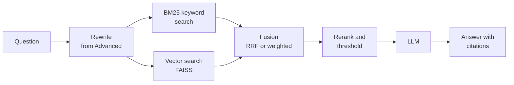

# 03. Hybrid Search RAG

**Category:** Retrieval Optimization  
**Core idea:** Run keyword search (BM25) and vector search over the same chunks, fuse the two ranked lists, then rerank and generate as in Advanced RAG.  
**Status:** In progress. Basic concept notes 01 to 09 done; notes 10 to 15 next.

## Table of Contents

- [Overview](#overview)
- [Why Hybrid Search Comes Next](#why-hybrid-search-comes-next)
- [Architecture](#architecture)
- [How It Works](#how-it-works)
- [When to Use](#when-to-use)
- [Limitations](#limitations)
- [Key Components](#key-components)
- [Folder Contents](#folder-contents)
- [Research Papers](#research-papers)
- [Navigation](#navigation)

## Overview

Dense embeddings capture meaning but can miss exact words: names, codes, numbers, rare terms and acronyms. Keyword search with BM25 finds exact words but misses paraphrases. Hybrid Search RAG runs both searches for every question and merges their ranked lists, with Reciprocal Rank Fusion (RRF) or a weighted combination of normalised scores. The merged candidates then go through the Advanced RAG stages (reranking, threshold, generation).

## Why Hybrid Search Comes Next

The [Advanced RAG](../02.%20Advanced%20RAG/) evaluation raised context precision but left correctness unchanged:

<table width="100%">
<thead><tr><th>Advanced RAG result</th><th>Value</th><th>What Hybrid Search changes</th><th>Target</th></tr></thead>
<tbody>
<tr><td>Correctness</td><td>0.84 (Naive 0.84)</td><td>Keyword search finds chunks with the exact terms of the question that dense search ranks low</td><td>0.90 or higher</td></tr>
<tr><td>Candidate hit rate (file level)</td><td>100%</td><td>Keep it while adding a second retriever</td><td>stay at 100%</td></tr>
<tr><td>Hit rate of the answer chunk</td><td>Not measured (file level only)</td><td>Measure whether the exact answer chunk is among the candidates</td><td>Measured and improved</td></tr>
<tr><td>Context precision</td><td>0.66</td><td>Unchanged reranker and threshold</td><td>stay at 0.65 or higher</td></tr>
<tr><td>Cost per question</td><td>Rs 0.048</td><td>BM25 is local and free; same number of reranked candidates</td><td>no increase</td></tr>
<tr><td>Time per question</td><td>2.7 s</td><td>BM25 search takes milliseconds; can run beside vector search</td><td>under 3 s</td></tr>
</tbody>
</table>

The two remaining failures point to retrieval: rag-corpus (the chunk naming the Wikipedia dense index was not retrieved) and rag-variants (the defining chunk was not among the best candidates). Details: [Advanced RAG API doc 11](../02.%20Advanced%20RAG/03.%20API/docs/11.%20Evaluation%20Results%20and%20Comparison%20with%20Naive%20RAG.md).

## Architecture

## How It Works

1. **Index twice:** the same chunks go into a BM25 keyword index and the FAISS vector index.
2. **Rewrite** the question as in Advanced RAG.
3. **Search both:** BM25 returns the chunks sharing the most informative words; FAISS returns the chunks closest in meaning.
4. **Fuse** the two ranked lists into one candidate list: RRF uses only ranks (score = sum of 1 / (60 + rank)); weighted fusion normalises the scores and mixes them with a weight alpha.
5. **Rerank and filter** the fused candidates with the Advanced RAG reranker and threshold, then **generate** the cited answer.

## When to Use

- Questions contain exact terms: names, product codes, error codes, numbers, acronyms, legal or medical terms.
- Mixed question styles: some keyword-like ("BM25 k1 b"), some natural language.
- Dense retrieval alone misses chunks that clearly contain the question's words.

## Limitations

- Two indexes to build, store and keep in sync.
- Fusion has parameters (RRF constant, weight alpha) that depend on the data and must be tuned.
- BM25 does not understand synonyms or paraphrases; it adds keyword noise for vague questions.
- Still one retrieval round: multi-hop questions need iterative methods.

## Key Components

- BM25 keyword index (text analysis, term statistics)
- FAISS vector index (from Naive RAG)
- Fusion: Reciprocal Rank Fusion and weighted score fusion
- Reranker and threshold (from Advanced RAG)
- Evaluation of each retriever and of the fusion

## Folder Contents

Read in this order, the same structure as Naive RAG and Advanced RAG.

<table width="100%">
<thead><tr><th>#</th><th>Folder</th><th>What it holds</th><th>Status</th></tr></thead>
<tbody>
<tr><td>1</td><td><a href="01.%20Notes/">01. Notes</a></td><td>Basic concepts of hybrid search, the three papers explained section by section, interview preparation</td><td>In progress</td></tr>
<tr><td>2</td><td><a href="02.%20Papers/">02. Papers</a></td><td>The research papers as PDFs</td><td>Done</td></tr>
<tr><td>3</td><td><a href="03.%20API/">03. API</a></td><td>FastAPI implementation built on the Advanced RAG API, with numbered design docs</td><td>Planned</td></tr>
<tr><td>4</td><td><a href="04.%20UI/">04. UI</a></td><td>React UI built on the Advanced RAG UI, showing keyword and vector results and the fusion</td><td>Planned</td></tr>
</tbody>
</table>

## Research Papers

<table width="100%">
<thead><tr><th>#</th><th>Paper</th><th>Year</th><th>Venue / Org</th><th>arXiv</th><th>Local copy</th></tr></thead>
<tbody>
<tr><td>1</td><td>Blended RAG: Improving RAG (Retriever-Augmented Generation) Accuracy with Semantic Search and Hybrid Query-Based Retrievers</td><td>2024</td><td>arXiv (IBM)</td><td><a href="https://arxiv.org/abs/2404.07220">2404.07220</a></td><td><a href="02.%20Papers/2404.07220_Blended-RAG.pdf">PDF</a></td></tr>
<tr><td>2</td><td>An Analysis of Fusion Functions for Hybrid Retrieval</td><td>2022</td><td>arXiv (Pinecone, UC Berkeley)</td><td><a href="https://arxiv.org/abs/2210.11934">2210.11934</a></td><td><a href="02.%20Papers/2210.11934_Fusion-Functions-Hybrid-Retrieval.pdf">PDF</a></td></tr>
<tr><td>3</td><td>Reciprocal Rank Fusion outperforms Condorcet and individual Rank Learning Methods</td><td>2009</td><td>SIGIR 2009 (University of Waterloo, Google)</td><td>-</td><td><a href="02.%20Papers/Cormack-2009_Reciprocal-Rank-Fusion.pdf">PDF</a></td></tr>
</tbody>
</table>

## Navigation

Previous: [02. Advanced RAG](../02.%20Advanced%20RAG/) | [Home](../README.md) | Next: [04. HyDE RAG](../04.%20HyDE%20RAG/)
