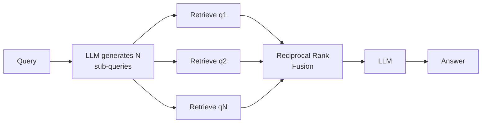

# 05. RAG-Fusion (Multi-Query)

**Category:** Query Transformation  
**Core idea:** Generate several query variants, retrieve for each, merge with Reciprocal Rank Fusion.  
**Status:** Research collected. Implementation planned.

## Table of Contents

- [Overview](#overview)
- [Architecture](#architecture)
- [How It Works](#how-it-works)
- [When to Use](#when-to-use)
- [Limitations](#limitations)
- [Key Components](#key-components)
- [Research Papers](#research-papers)
- [Navigation](#navigation)

## Overview

One query sees the corpus from one angle. RAG-Fusion asks the LLM for several reformulations of the user question, retrieves documents for each, and merges all ranked lists with Reciprocal Rank Fusion. Documents that rank well across many variants rise to the top.

## Architecture

## How It Works

1. Generate 3-5 diverse reformulations of the query.
2. Retrieve top-k for each reformulation in parallel.
3. Merge lists with RRF: score = sum of 1 / (k + rank).
4. Generate the answer from the fused context.

## When to Use

- Broad or multi-faceted questions.
- Recall matters more than latency.

## Limitations

- N times more retrieval calls.
- Sub-queries can drift off topic.

## Key Components

- Multi-query generator
- Retriever
- RRF merger

## Research Papers

<table width="100%">
<thead><tr><th>#</th><th>Paper</th><th>Year</th><th>Venue / Org</th><th>arXiv</th><th>Local copy</th></tr></thead>
<tbody>
<tr><td>1</td><td>RAG-Fusion: a New Take on Retrieval-Augmented Generation</td><td>2024</td><td>arXiv (Infineon)</td><td><a href="https://arxiv.org/abs/2402.03367">2402.03367</a></td><td><a href="papers/2402.03367_RAG-Fusion.pdf">PDF</a></td></tr>
</tbody>
</table>

## Navigation

Previous: [04. HyDE RAG](../04.%20HyDE%20RAG/) | [Home](../README.md) | Next: [06. Contextual Chunking RAG](../06.%20Contextual%20Chunking%20RAG/)
