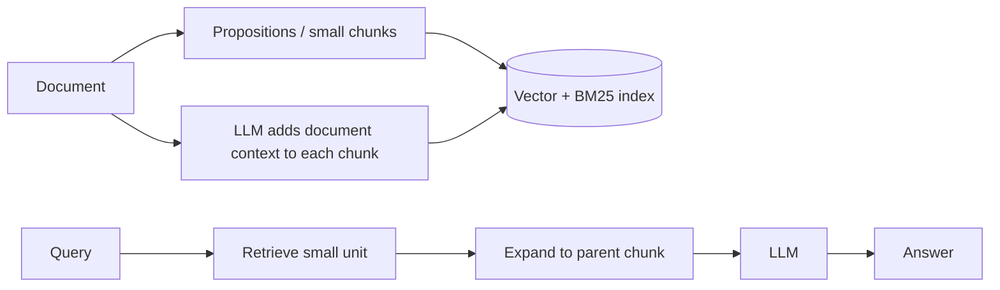

# 06. Contextual and Proposition Chunking RAG

**Category:** Indexing Optimization  
**Core idea:** Index better units: atomic propositions, small-to-big parent chunks, or chunks prefixed with document context.  
**Status:** Research collected. Implementation planned.

## Table of Contents

- [Overview](#overview)
- [Architecture](#architecture)
- [How It Works](#how-it-works)
- [When to Use](#when-to-use)
- [Limitations](#limitations)
- [Key Components](#key-components)
- [Research Papers](#research-papers)
- [Navigation](#navigation)

## Overview

Retrieval quality depends on what is indexed. This architecture changes the indexing stage: split text into atomic propositions (Dense X), retrieve small chunks but return their larger parent (small-to-big), or prepend an LLM-written summary of the parent document to each chunk before embedding (Contextual Retrieval, described by Anthropic in 2024, no paper).

## Architecture

## How It Works

1. Split documents into propositions or small child chunks linked to parent chunks.
2. Optionally prepend a short LLM-generated context line to each chunk.
3. Embed and index the small units (plus BM25).
4. Retrieve small units, expand to their parents, then generate.

## When to Use

- Chunks lose meaning out of context (pronouns, tables, sections).
- Precise fact lookup.

## Limitations

- Indexing cost goes up (LLM call per chunk).
- Bigger index.

## Key Components

- Proposition extractor
- Parent-child doc store
- Context generator
- Hybrid index

## Research Papers

<table width="100%">
<thead><tr><th>#</th><th>Paper</th><th>Year</th><th>Venue / Org</th><th>arXiv</th><th>Local copy</th></tr></thead>
<tbody>
<tr><td>1</td><td>Dense X Retrieval: What Retrieval Granularity Should We Use?</td><td>2023</td><td>EMNLP 2024</td><td><a href="https://arxiv.org/abs/2312.06648">2312.06648</a></td><td><a href="papers/2312.06648_Dense-X-Propositions.pdf">PDF</a></td></tr>
</tbody>
</table>

## Navigation

Previous: [05. RAG Fusion](../05.%20RAG%20Fusion/) | [Home](../README.md) | Next: [07. RAPTOR RAG](../07.%20RAPTOR%20RAG/)
