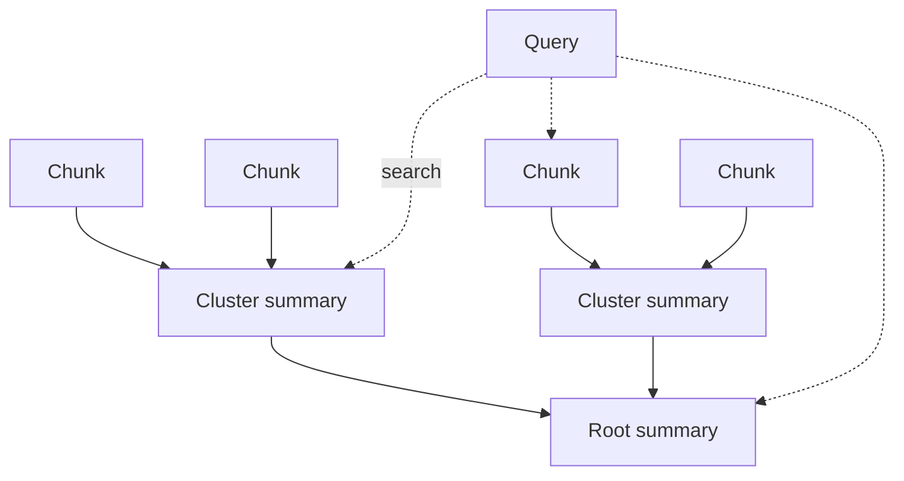

# 07. RAPTOR (Hierarchical Tree RAG)

**Category:** Indexing Optimization  
**Core idea:** Recursively cluster and summarize chunks into a tree; retrieve across all abstraction levels.  
**Status:** Research collected. Implementation planned.

## Table of Contents

- [Overview](#overview)
- [Architecture](#architecture)
- [How It Works](#how-it-works)
- [When to Use](#when-to-use)
- [Limitations](#limitations)
- [Key Components](#key-components)
- [Research Papers](#research-papers)
- [Navigation](#navigation)

## Overview

RAPTOR builds a tree over the corpus. Leaf nodes are chunks. Chunks are clustered by embedding, each cluster is summarized by an LLM, and the summaries are clustered and summarized again up to a root. Retrieval searches all levels, so the system answers both detail questions and whole-document questions.

## Architecture

## How It Works

1. Chunk and embed documents (leaf level).
2. Cluster embeddings (GMM + UMAP) and summarize each cluster.
3. Repeat clustering and summarizing until one root remains.
4. At query time search the flattened tree (all levels) and generate.

## When to Use

- Long documents (books, reports, manuals).
- Questions that need high-level synthesis.

## Limitations

- Expensive index build.
- Rebuild needed when corpus changes a lot.

## Key Components

- Clustering (UMAP + GMM)
- Summarizer LLM
- Tree store
- Vector DB

## Research Papers

<table width="100%">
<thead><tr><th>#</th><th>Paper</th><th>Year</th><th>Venue / Org</th><th>arXiv</th><th>Local copy</th></tr></thead>
<tbody>
<tr><td>1</td><td>RAPTOR: Recursive Abstractive Processing for Tree-Organized Retrieval</td><td>2024</td><td>ICLR 2024 (Stanford)</td><td><a href="https://arxiv.org/abs/2401.18059">2401.18059</a></td><td><a href="papers/2401.18059_RAPTOR.pdf">PDF</a></td></tr>
</tbody>
</table>

## Navigation

Previous: [06. Contextual Chunking RAG](../06.%20Contextual%20Chunking%20RAG/) | [Home](../README.md) | Next: [08. Self RAG](../08.%20Self%20RAG/)
