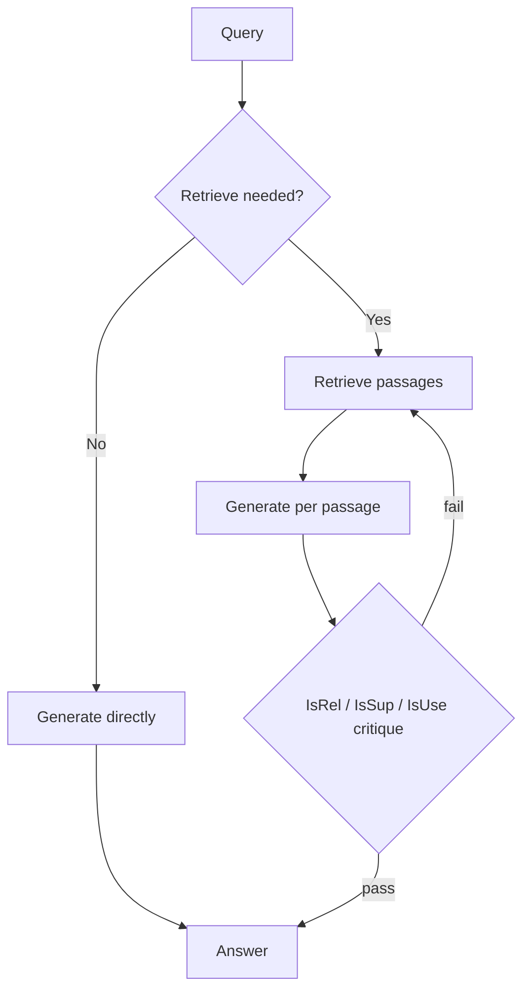

# 08. Self-RAG

> **Category:** Self-Reflective  
> **Core idea:** LLM decides when to retrieve and critiques its own output with reflection tokens.  
> **Status:** Research collected. Implementation planned.

## Table of Contents

- [Overview](#overview)
- [Architecture](#architecture)
- [How It Works](#how-it-works)
- [When to Use](#when-to-use)
- [Limitations](#limitations)
- [Key Components](#key-components)
- [Research Papers](#research-papers)
- [Folder Structure](#folder-structure)
- [Navigation](#navigation)

## Overview

Self-RAG trains (or prompts) the model to emit reflection tokens: Retrieve (is retrieval needed?), IsRel (is the passage relevant?), IsSup (is the answer supported?) and IsUse (is the answer useful?). The model retrieves on demand, generates candidate segments per passage, and keeps the best-scored segment.

## Architecture



## How It Works

1. Decide whether retrieval is needed for the query or segment.
2. Retrieve passages and generate one candidate per passage.
3. Score candidates for relevance, support and usefulness.
4. Select the best candidate; loop if no candidate passes.

## When to Use

- Mixed traffic where many queries need no retrieval.
- Hallucination control is critical.

## Limitations

- Original method needs a fine-tuned critic model.
- Prompt-only versions are less reliable.

## Key Components

- Retrieval decision node
- Relevance grader
- Hallucination grader
- Answer grader
- LangGraph state machine

## Research Papers

<table width="100%">
<thead><tr><th>#</th><th>Paper</th><th>Year</th><th>Venue / Org</th><th>arXiv</th><th>Local copy</th></tr></thead>
<tbody>
<tr><td>1</td><td>Self-RAG: Learning to Retrieve, Generate, and Critique through Self-Reflection</td><td>2023</td><td>ICLR 2024 (UW / AI2)</td><td><a href="https://arxiv.org/abs/2310.11511">2310.11511</a></td><td><a href="papers/2310.11511_Self-RAG.pdf">PDF</a></td></tr>
</tbody>
</table>

## Folder Structure

```text
08-Self-RAG/
├── README.md        # This file
└── papers/         # Research papers (PDF)
```

Implementation code (`src/`, `notebooks/`, `requirements.txt`) will be added when this architecture is built end to end.

## Navigation

[← RAPTOR (Hierarchical Tree RAG)](../07-RAPTOR-RAG/) | [Home](../README.md) | [Corrective RAG (CRAG) →](../09-Corrective-RAG/)
