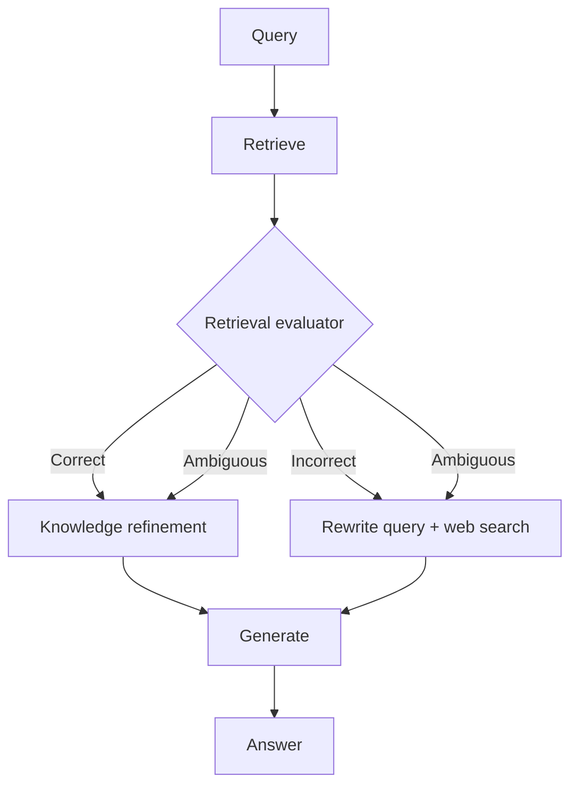

# 09. Corrective RAG (CRAG)

**Category:** Self-Reflective  
**Core idea:** Grade retrieved documents; if quality is low, refine the query and fall back to web search.  
**Status:** Research collected. Implementation planned.

## Table of Contents

- [Overview](#overview)
- [Architecture](#architecture)
- [How It Works](#how-it-works)
- [When to Use](#when-to-use)
- [Limitations](#limitations)
- [Key Components](#key-components)
- [Research Papers](#research-papers)
- [Navigation](#navigation)

## Overview

CRAG adds a lightweight retrieval evaluator after retrieval. Each document is graded Correct, Ambiguous or Incorrect. Correct documents are refined (decompose-then-recompose to keep only key strips). Incorrect retrieval triggers a query rewrite and web search. Ambiguous combines both sources.

## Architecture

## How It Works

1. Retrieve documents from the vector store.
2. Grade each document for relevance (evaluator model or LLM grader).
3. Correct: filter document strips to keep relevant content.
4. Incorrect: rewrite the query and search the web.
5. Generate from the corrected knowledge.

## When to Use

- Internal knowledge base is incomplete.
- Questions about recent events.

## Limitations

- Web search adds latency and source-trust issues.
- Grader errors propagate.

## Key Components

- Retriever
- Document grader
- Query rewriter
- Web search tool (Tavily)
- LangGraph

## Research Papers

<table width="100%">
<thead><tr><th>#</th><th>Paper</th><th>Year</th><th>Venue / Org</th><th>arXiv</th><th>Local copy</th></tr></thead>
<tbody>
<tr><td>1</td><td>Corrective Retrieval Augmented Generation</td><td>2024</td><td>arXiv (USTC / Google)</td><td><a href="https://arxiv.org/abs/2401.15884">2401.15884</a></td><td><a href="papers/2401.15884_Corrective-RAG.pdf">PDF</a></td></tr>
</tbody>
</table>

## Navigation

Previous: [08. Self RAG](../08.%20Self%20RAG/) | [Home](../README.md) | Next: [10. Adaptive RAG](../10.%20Adaptive%20RAG/)
