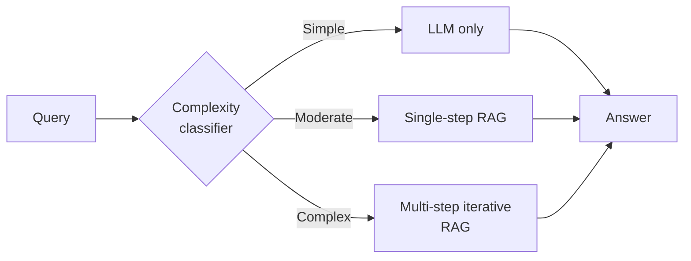

# 10. Adaptive RAG

**Category:** Self-Reflective / Routing  
**Core idea:** Classify query complexity and route to no-retrieval, single-step or multi-step retrieval.  
**Status:** Research collected. Implementation planned.

## Table of Contents

- [Overview](#overview)
- [Architecture](#architecture)
- [How It Works](#how-it-works)
- [When to Use](#when-to-use)
- [Limitations](#limitations)
- [Key Components](#key-components)
- [Research Papers](#research-papers)
- [Navigation](#navigation)

## Overview

Not every question needs the same pipeline. Adaptive-RAG trains a small classifier to predict query complexity: simple queries go straight to the LLM, moderate queries use single-step RAG, and complex queries use iterative multi-step RAG. This balances accuracy against cost and latency.

## Architecture

## How It Works

1. Classify the query (A: no retrieval, B: single-step, C: multi-step).
2. Route to the matching strategy.
3. Run the chosen pipeline and return the answer.

## When to Use

- High traffic with mixed difficulty.
- Cost and latency budgets matter.

## Limitations

- Router mistakes cause wrong strategy.
- Classifier needs labelled data or good prompts.

## Key Components

- Query classifier / router
- LLM-only path
- Single-step RAG
- Iterative RAG

## Research Papers

<table width="100%">
<thead><tr><th>#</th><th>Paper</th><th>Year</th><th>Venue / Org</th><th>arXiv</th><th>Local copy</th></tr></thead>
<tbody>
<tr><td>1</td><td>Adaptive-RAG: Learning to Adapt Retrieval-Augmented LLMs through Question Complexity</td><td>2024</td><td>NAACL 2024 (KAIST)</td><td><a href="https://arxiv.org/abs/2403.14403">2403.14403</a></td><td><a href="papers/2403.14403_Adaptive-RAG.pdf">PDF</a></td></tr>
</tbody>
</table>

## Navigation

Previous: [09. Corrective RAG](../09.%20Corrective%20RAG/) | [Home](../README.md) | Next: [11. Active Iterative RAG](../11.%20Active%20Iterative%20RAG/)
