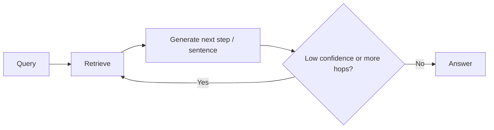

# 11. Active & Iterative RAG (FLARE / IRCoT)

> **Category:** Iterative / Multi-hop  
> **Core idea:** Retrieve repeatedly during generation: when confidence drops (FLARE) or after each reasoning step (IRCoT).  
> **Status:** Research collected. Implementation planned.

## Table of Contents

- [Overview](#overview)
- [Architecture](#architecture)
- [How It Works](#how-it-works)
- [When to Use](#when-to-use)
- [Limitations](#limitations)
- [Key Components](#key-components)
- [Research Papers](#research-papers)
- [Folder Structure](#folder-structure)
- [Navigation](#navigation)

## Overview

Single retrieval fails on multi-hop questions where the next fact depends on the previous one. FLARE generates a look-ahead sentence and retrieves again when token confidence is low. IRCoT interleaves chain-of-thought steps with retrieval: each reasoning sentence becomes the next retrieval query.

## Architecture



## How It Works

1. Retrieve initial context for the question.
2. Generate one reasoning step or sentence.
3. If confidence is low or the step needs new facts, use it as a new query and retrieve.
4. Repeat until the answer is complete.

## When to Use

- Multi-hop QA (HotpotQA, 2WikiMultihopQA).
- Long-form generation.

## Limitations

- Many LLM and retrieval calls.
- Needs token log-probs for FLARE.

## Key Components

- Iterative controller
- Confidence checker
- Retriever
- CoT prompt

## Research Papers

<table width="100%">
<thead><tr><th>#</th><th>Paper</th><th>Year</th><th>Venue / Org</th><th>arXiv</th><th>Local copy</th></tr></thead>
<tbody>
<tr><td>1</td><td>Active Retrieval Augmented Generation</td><td>2023</td><td>EMNLP 2023 (CMU)</td><td><a href="https://arxiv.org/abs/2305.06983">2305.06983</a></td><td><a href="papers/2305.06983_FLARE.pdf">PDF</a></td></tr>
<tr><td>2</td><td>Interleaving Retrieval with Chain-of-Thought Reasoning for Multi-Step Questions</td><td>2022</td><td>ACL 2023 (Stony Brook / AI2)</td><td><a href="https://arxiv.org/abs/2212.10509">2212.10509</a></td><td><a href="papers/2212.10509_IRCoT.pdf">PDF</a></td></tr>
</tbody>
</table>

## Folder Structure

```text
11-Active-Iterative-RAG/
├── README.md        # This file
└── papers/         # Research papers (PDF)
```

Implementation code (`src/`, `notebooks/`, `requirements.txt`) will be added when this architecture is built end to end.

## Navigation

[← Adaptive RAG](../10-Adaptive-RAG/) | [Home](../README.md) | [Speculative RAG →](../12-Speculative-RAG/)
