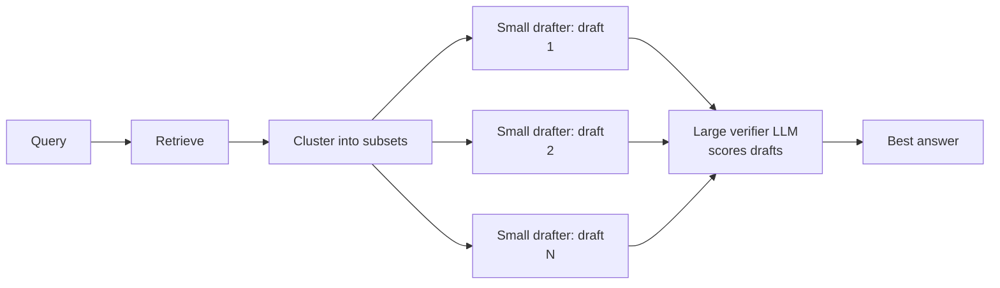

# 12. Speculative RAG

**Category:** Efficiency  
**Core idea:** Small specialist model drafts answers from document subsets in parallel; large model verifies the best draft.  
**Status:** Research collected. Implementation planned.

## Table of Contents

- [Overview](#overview)
- [Architecture](#architecture)
- [How It Works](#how-it-works)
- [When to Use](#when-to-use)
- [Limitations](#limitations)
- [Key Components](#key-components)
- [Research Papers](#research-papers)
- [Navigation](#navigation)

## Overview

Speculative RAG splits retrieved documents into diverse subsets. A small, fast drafter LM writes an answer draft plus rationale per subset in parallel. A large generalist LM then scores the drafts and selects the best one, without reading all documents itself. This improves both accuracy and latency.

## Architecture

## How It Works

1. Retrieve documents and cluster them into diverse subsets.
2. Draft an answer and rationale per subset with a small model, in parallel.
3. Score each draft with the large model.
4. Return the highest-scoring draft.

## When to Use

- Latency-sensitive production with many retrieved docs.

## Limitations

- Two models to serve.
- Best results need a tuned drafter.

## Key Components

- Document clustering
- Drafter LM
- Verifier LLM

## Research Papers

<table width="100%">
<thead><tr><th>#</th><th>Paper</th><th>Year</th><th>Venue / Org</th><th>arXiv</th><th>Local copy</th></tr></thead>
<tbody>
<tr><td>1</td><td>Speculative RAG: Enhancing Retrieval Augmented Generation through Drafting</td><td>2024</td><td>ICLR 2025 (Google)</td><td><a href="https://arxiv.org/abs/2407.08223">2407.08223</a></td><td><a href="papers/2407.08223_Speculative-RAG.pdf">PDF</a></td></tr>
</tbody>
</table>

## Navigation

Previous: [11. Active Iterative RAG](../11.%20Active%20Iterative%20RAG/) | [Home](../README.md) | Next: [13. Graph RAG](../13.%20Graph%20RAG/)
