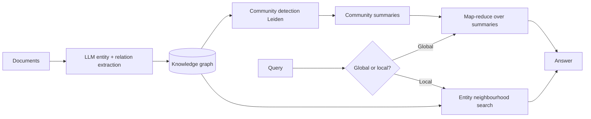

# 13. Graph RAG

**Category:** Graph-based  
**Core idea:** Extract an entity-relation knowledge graph, build community summaries, answer global and local queries.  
**Status:** Research collected. Implementation planned.

## Table of Contents

- [Overview](#overview)
- [Architecture](#architecture)
- [How It Works](#how-it-works)
- [When to Use](#when-to-use)
- [Limitations](#limitations)
- [Key Components](#key-components)
- [Research Papers](#research-papers)
- [Navigation](#navigation)

## Overview

Microsoft GraphRAG uses an LLM to extract entities and relations into a knowledge graph, detects communities (Leiden algorithm) and writes a summary per community. Global questions ("what are the main themes?") are answered map-reduce style over community summaries. Local questions traverse entities and neighbours. Think-on-Graph adds LLM-guided beam search over an existing KG.

## Architecture

## How It Works

1. Chunk documents and extract entities, relations and claims with an LLM.
2. Build the graph and detect hierarchical communities.
3. Summarize each community.
4. Global search: map-reduce over community summaries. Local search: traverse entity neighbourhoods.

## When to Use

- Questions about themes and relations across a whole corpus.
- Connected data (orgs, people, events).

## Limitations

- Very expensive indexing (many LLM calls).
- Graph updates are hard.

## Key Components

- Entity extractor
- Graph DB (Neo4j / NetworkX)
- Leiden clustering
- Community summarizer

## Research Papers

<table width="100%">
<thead><tr><th>#</th><th>Paper</th><th>Year</th><th>Venue / Org</th><th>arXiv</th><th>Local copy</th></tr></thead>
<tbody>
<tr><td>1</td><td>From Local to Global: A Graph RAG Approach to Query-Focused Summarization</td><td>2024</td><td>arXiv (Microsoft Research)</td><td><a href="https://arxiv.org/abs/2404.16130">2404.16130</a></td><td><a href="papers/2404.16130_GraphRAG-Microsoft.pdf">PDF</a></td></tr>
<tr><td>2</td><td>Think-on-Graph: Deep and Responsible Reasoning of LLMs on Knowledge Graph</td><td>2023</td><td>ICLR 2024</td><td><a href="https://arxiv.org/abs/2307.07697">2307.07697</a></td><td><a href="papers/2307.07697_Think-on-Graph.pdf">PDF</a></td></tr>
</tbody>
</table>

## Navigation

Previous: [12. Speculative RAG](../12.%20Speculative%20RAG/) | [Home](../README.md) | Next: [14. LightRAG](../14.%20LightRAG/)
