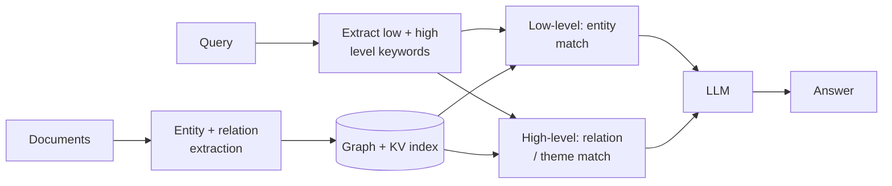

# 14. LightRAG

**Category:** Graph-based  
**Core idea:** Graph-enhanced index with dual-level (low/high) keyword retrieval and cheap incremental updates.  
**Status:** Research collected. Implementation planned.

## Table of Contents

- [Overview](#overview)
- [Architecture](#architecture)
- [How It Works](#how-it-works)
- [When to Use](#when-to-use)
- [Limitations](#limitations)
- [Key Components](#key-components)
- [Research Papers](#research-papers)
- [Navigation](#navigation)

## Overview

LightRAG keeps the benefits of graph structure at much lower cost than GraphRAG. It extracts entities and relations into a graph, indexes them with key-value profiles, and retrieves at two levels: low-level (specific entities) and high-level (broad themes). New documents merge into the graph without a rebuild.

## Architecture

## How It Works

1. Extract entities and relations and deduplicate them into a graph.
2. Create key-value profiles for nodes and edges and embed them.
3. Extract low-level and high-level keywords from the query.
4. Retrieve matching nodes, edges and neighbours; generate.

## When to Use

- Want graph benefits on a budget.
- Corpus changes often.

## Limitations

- Extraction quality depends on the LLM.
- Younger ecosystem than GraphRAG.

## Key Components

- Entity extractor
- Graph store
- KV store
- Vector DB
- Dual-level retriever

## Research Papers

<table width="100%">
<thead><tr><th>#</th><th>Paper</th><th>Year</th><th>Venue / Org</th><th>arXiv</th><th>Local copy</th></tr></thead>
<tbody>
<tr><td>1</td><td>LightRAG: Simple and Fast Retrieval-Augmented Generation</td><td>2024</td><td>arXiv (HKU)</td><td><a href="https://arxiv.org/abs/2410.05779">2410.05779</a></td><td><a href="papers/2410.05779_LightRAG.pdf">PDF</a></td></tr>
</tbody>
</table>

## Navigation

Previous: [13. Graph RAG](../13.%20Graph%20RAG/) | [Home](../README.md) | Next: [15. HippoRAG](../15.%20HippoRAG/)
