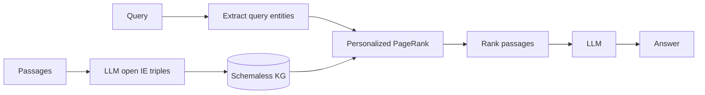

# 15. HippoRAG

> **Category:** Graph-based / Memory  
> **Core idea:** Hippocampus-inspired: open KG plus Personalized PageRank for single-step multi-hop retrieval.  
> **Status:** Research collected. Implementation planned.

## Table of Contents

- [Overview](#overview)
- [Architecture](#architecture)
- [How It Works](#how-it-works)
- [When to Use](#when-to-use)
- [Limitations](#limitations)
- [Key Components](#key-components)
- [Research Papers](#research-papers)
- [Folder Structure](#folder-structure)
- [Navigation](#navigation)

## Overview

HippoRAG models long-term memory after the hippocampal indexing theory. An LLM builds a schemaless knowledge graph (the neocortex role). At query time, query entities seed a Personalized PageRank over the graph (the hippocampus role), which ranks passages connected through multiple hops in one step.

## Architecture



## How It Works

1. Extract (subject, relation, object) triples from each passage.
2. Build a KG with synonym edges between similar entities.
3. Link query entities to graph nodes and run Personalized PageRank.
4. Rank passages by node scores and generate.

## When to Use

- Multi-hop QA without iterative retrieval cost.

## Limitations

- Depends on triple extraction quality.

## Key Components

- Open IE extractor
- Graph store
- PPR engine
- Retriever

## Research Papers

<table width="100%">
<thead><tr><th>#</th><th>Paper</th><th>Year</th><th>Venue / Org</th><th>arXiv</th><th>Local copy</th></tr></thead>
<tbody>
<tr><td>1</td><td>HippoRAG: Neurobiologically Inspired Long-Term Memory for LLMs</td><td>2024</td><td>NeurIPS 2024 (OSU)</td><td><a href="https://arxiv.org/abs/2405.14831">2405.14831</a></td><td><a href="papers/2405.14831_HippoRAG.pdf">PDF</a></td></tr>
</tbody>
</table>

## Folder Structure

```text
15-HippoRAG/
├── README.md        # This file
└── papers/         # Research papers (PDF)
```

Implementation code (`src/`, `notebooks/`, `requirements.txt`) will be added when this architecture is built end to end.

## Navigation

[← LightRAG](../14-LightRAG/) | [Home](../README.md) | [Agentic RAG →](../16-Agentic-RAG/)
