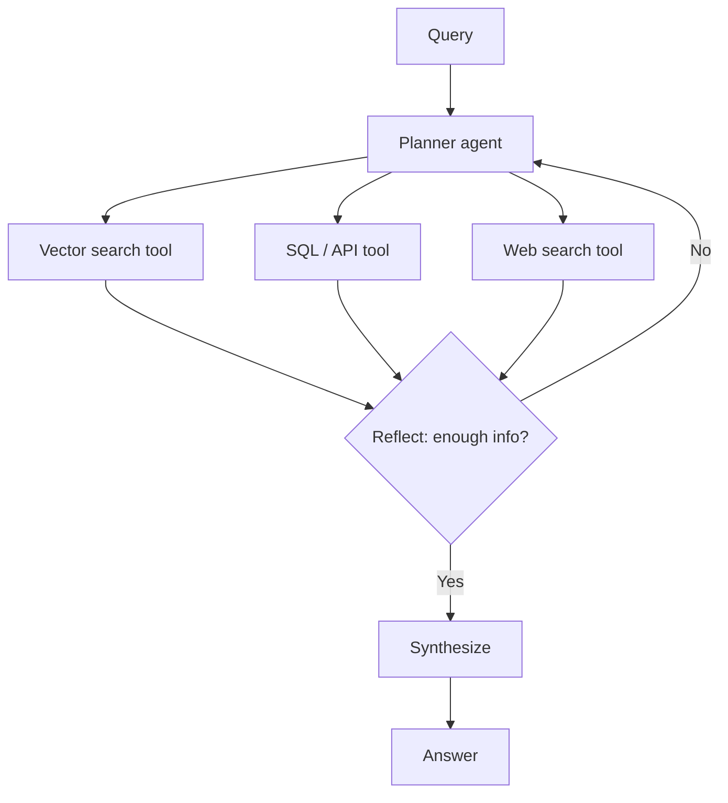

# 16. Agentic RAG

> **Category:** Agentic  
> **Core idea:** LLM agents plan, choose tools and retrievers, reflect and iterate until the task is solved.  
> **Status:** Research collected. Implementation planned.

## Table of Contents

- [Overview](#overview)
- [Architecture](#architecture)
- [How It Works](#how-it-works)
- [When to Use](#when-to-use)
- [Limitations](#limitations)
- [Key Components](#key-components)
- [Research Papers](#research-papers)
- [Folder Structure](#folder-structure)
- [Navigation](#navigation)

## Overview

Agentic RAG puts an autonomous agent in charge of the retrieval loop. The agent plans the task, picks tools (vector search, SQL, web search, APIs), evaluates results, reflects and retries. Patterns include a single router agent, multi-agent systems with specialist retrievers, and hierarchical planner-executor setups.

## Architecture



## How It Works

1. Agent analyses the query and makes a plan.
2. Agent calls retrieval tools or sub-agents.
3. Agent reflects on results and decides to continue or stop.
4. Agent synthesizes the final answer with citations.

## When to Use

- Several heterogeneous data sources.
- Complex research-style tasks.

## Limitations

- Non-deterministic, harder to debug.
- Higher cost and latency.
- Needs guardrails and tracing.

## Key Components

- Agent framework (LangGraph)
- Tool registry
- Memory
- Tracing (LangSmith / Langfuse)

## Research Papers

<table width="100%">
<thead><tr><th>#</th><th>Paper</th><th>Year</th><th>Venue / Org</th><th>arXiv</th><th>Local copy</th></tr></thead>
<tbody>
<tr><td>1</td><td>Agentic Retrieval-Augmented Generation: A Survey on Agentic RAG</td><td>2025</td><td>arXiv</td><td><a href="https://arxiv.org/abs/2501.09136">2501.09136</a></td><td><a href="papers/2501.09136_AgenticRAG-Survey.pdf">PDF</a></td></tr>
</tbody>
</table>

## Folder Structure

```text
16-Agentic-RAG/
├── README.md        # This file
└── papers/         # Research papers (PDF)
```

Implementation code (`src/`, `notebooks/`, `requirements.txt`) will be added when this architecture is built end to end.

## Navigation

[← HippoRAG](../15-HippoRAG/) | [Home](../README.md) | [Reasoning Search RAG (Search-R1) →](../17-Reasoning-Search-RAG/)
