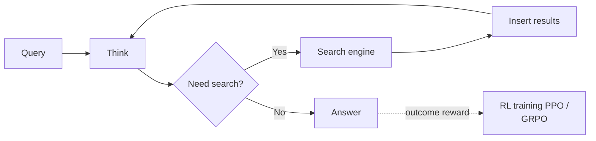

# 17. Reasoning Search RAG (Search-R1)

**Category:** Agentic / RL  
**Core idea:** Train the LLM with reinforcement learning to interleave reasoning with search engine calls.  
**Status:** Research collected. Implementation planned.

## Table of Contents

- [Overview](#overview)
- [Architecture](#architecture)
- [How It Works](#how-it-works)
- [When to Use](#when-to-use)
- [Limitations](#limitations)
- [Key Components](#key-components)
- [Research Papers](#research-papers)
- [Navigation](#navigation)

## Overview

Search-R1 trains a reasoning model to emit `<search>` queries inside its chain of thought, read the returned results and continue reasoning, using only an outcome reward (answer correctness). This is the research basis for deep-research style agents where search is a learned skill, not a fixed pipeline step.

## Architecture

## How It Works

1. Model reasons step by step.
2. Model emits a search query when it lacks knowledge.
3. Search results are inserted into context and reasoning continues.
4. During training, RL rewards correct final answers.

## When to Use

- Research on deep-research agents.
- Have GPU budget for RL fine-tuning.

## Limitations

- Training is expensive.
- Needs a stable search environment.

## Key Components

- Base LLM
- Search engine / retriever
- RL trainer (veRL)
- Reward function

## Research Papers

<table width="100%">
<thead><tr><th>#</th><th>Paper</th><th>Year</th><th>Venue / Org</th><th>arXiv</th><th>Local copy</th></tr></thead>
<tbody>
<tr><td>1</td><td>Search-R1: Training LLMs to Reason and Leverage Search Engines with RL</td><td>2025</td><td>arXiv (UIUC)</td><td><a href="https://arxiv.org/abs/2503.09516">2503.09516</a></td><td><a href="papers/2503.09516_Search-R1.pdf">PDF</a></td></tr>
</tbody>
</table>

## Navigation

Previous: [16. Agentic RAG](../16.%20Agentic%20RAG/) | [Home](../README.md) | Next: [18. Multimodal RAG](../18.%20Multimodal%20RAG/)
