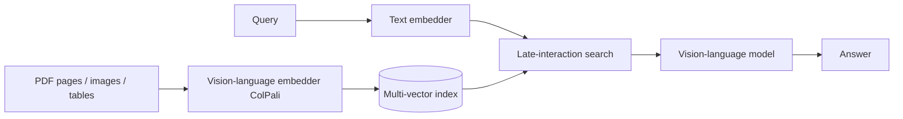

# 18. Multimodal RAG

**Category:** Multimodal  
**Core idea:** Retrieve over images, tables, charts and page screenshots, not only text.  
**Status:** Research collected. Implementation planned.

## Table of Contents

- [Overview](#overview)
- [Architecture](#architecture)
- [How It Works](#how-it-works)
- [When to Use](#when-to-use)
- [Limitations](#limitations)
- [Key Components](#key-components)
- [Research Papers](#research-papers)
- [Navigation](#navigation)

## Overview

Real documents contain figures, tables and layouts that text extraction loses. Multimodal RAG embeds images and text in a shared space (MuRAG), or embeds whole page screenshots with a vision-language model (ColPali late interaction, VisRAG), so retrieval and generation work directly on visual content.

## Architecture

## How It Works

1. Render document pages as images (or extract images and tables).
2. Embed pages with a VLM retriever (ColPali / ColQwen).
3. Retrieve pages for the text query with late interaction (MaxSim).
4. Pass page images plus query to a VLM to generate the answer.

## When to Use

- Slide decks, scanned PDFs, reports with charts.
- Layout carries meaning.

## Limitations

- Bigger indexes (multi-vector).
- VLM inference cost.

## Key Components

- Page renderer
- ColPali / ColQwen
- Multi-vector DB
- VLM (Claude / GPT-4o / Qwen-VL)

## Research Papers

<table width="100%">
<thead><tr><th>#</th><th>Paper</th><th>Year</th><th>Venue / Org</th><th>arXiv</th><th>Local copy</th></tr></thead>
<tbody>
<tr><td>1</td><td>MuRAG: Multimodal Retrieval-Augmented Generator for Open QA over Images and Text</td><td>2022</td><td>EMNLP 2022 (Google)</td><td><a href="https://arxiv.org/abs/2210.02928">2210.02928</a></td><td><a href="papers/2210.02928_MuRAG.pdf">PDF</a></td></tr>
<tr><td>2</td><td>ColPali: Efficient Document Retrieval with Vision Language Models</td><td>2024</td><td>ICLR 2025</td><td><a href="https://arxiv.org/abs/2407.01449">2407.01449</a></td><td><a href="papers/2407.01449_ColPali.pdf">PDF</a></td></tr>
<tr><td>3</td><td>VisRAG: Vision-based RAG on Multi-modality Documents</td><td>2024</td><td>ICLR 2025 (Tsinghua)</td><td><a href="https://arxiv.org/abs/2410.10594">2410.10594</a></td><td><a href="papers/2410.10594_VisRAG.pdf">PDF</a></td></tr>
<tr><td>4</td><td>Ask in Any Modality: A Comprehensive Survey on Multimodal RAG</td><td>2025</td><td>arXiv</td><td><a href="https://arxiv.org/abs/2502.08826">2502.08826</a></td><td><a href="papers/2502.08826_MultimodalRAG-Survey.pdf">PDF</a></td></tr>
</tbody>
</table>

## Navigation

Previous: [17. Reasoning Search RAG](../17.%20Reasoning%20Search%20RAG/) | [Home](../README.md) | Next: [19. Long RAG](../19.%20Long%20RAG/)
