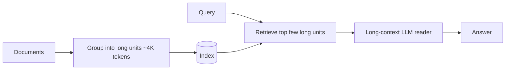

# 19. LongRAG

**Category:** Long-context  
**Core idea:** Use long retrieval units (4K+ tokens) and a long-context reader to cut retrieval burden.  
**Status:** Research collected. Implementation planned.

## Table of Contents

- [Overview](#overview)
- [Architecture](#architecture)
- [How It Works](#how-it-works)
- [When to Use](#when-to-use)
- [Limitations](#limitations)
- [Key Components](#key-components)
- [Research Papers](#research-papers)
- [Navigation](#navigation)

## Overview

Classic RAG uses short passages, so the retriever must find a needle in millions of units. LongRAG groups related documents into long units (about 4K tokens), retrieves only a few of them, and lets a long-context LLM extract the answer. Retriever recall rises sharply because there are far fewer units.

## Architecture

## How It Works

1. Group related documents into long retrieval units.
2. Embed and index the long units.
3. Retrieve a small number of units.
4. Use a long-context LLM to read and answer.

## When to Use

- Long-context models are available and affordable.
- Answers need wide context.

## Limitations

- Higher token cost per query.
- Lost-in-the-middle effects.

## Key Components

- Document grouper
- Long-unit retriever
- Long-context LLM

## Research Papers

<table width="100%">
<thead><tr><th>#</th><th>Paper</th><th>Year</th><th>Venue / Org</th><th>arXiv</th><th>Local copy</th></tr></thead>
<tbody>
<tr><td>1</td><td>LongRAG: Enhancing RAG with Long-context LLMs</td><td>2024</td><td>arXiv (Waterloo)</td><td><a href="https://arxiv.org/abs/2406.15319">2406.15319</a></td><td><a href="papers/2406.15319_LongRAG.pdf">PDF</a></td></tr>
</tbody>
</table>

## Navigation

Previous: [18. Multimodal RAG](../18.%20Multimodal%20RAG/) | [Home](../README.md) | Next: [20. Memory RAG](../20.%20Memory%20RAG/)
