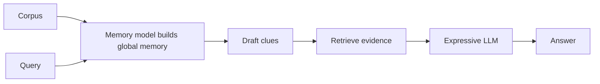

# 20. MemoRAG (Memory-Augmented RAG)

**Category:** Long-context / Memory  
**Core idea:** A light memory model forms a global memory of the corpus and drafts clues that guide retrieval.  
**Status:** Research collected. Implementation planned.

## Table of Contents

- [Overview](#overview)
- [Architecture](#architecture)
- [How It Works](#how-it-works)
- [When to Use](#when-to-use)
- [Limitations](#limitations)
- [Key Components](#key-components)
- [Research Papers](#research-papers)
- [Navigation](#navigation)

## Overview

MemoRAG adds a global memory module. A light long-context model reads the full corpus into a compressed memory. For a query, the memory model generates draft answers and clues, which become better retrieval queries. A strong LLM then generates the final answer from the retrieved evidence.

## Architecture

## How It Works

1. Encode the full corpus into a compressed global memory.
2. Generate clues and draft answers for the query from memory.
3. Retrieve evidence with the clues.
4. Generate the final answer.

## When to Use

- Implicit or ambiguous information needs.
- Summarization over long corpora.

## Limitations

- Needs a memory model and corpus pre-encoding.

## Key Components

- Memory model
- Clue generator
- Retriever
- Generator LLM

## Research Papers

<table width="100%">
<thead><tr><th>#</th><th>Paper</th><th>Year</th><th>Venue / Org</th><th>arXiv</th><th>Local copy</th></tr></thead>
<tbody>
<tr><td>1</td><td>MemoRAG: Boosting Long Context Processing with Global Memory-Enhanced Retrieval</td><td>2024</td><td>WWW 2025 (BAAI)</td><td><a href="https://arxiv.org/abs/2409.05591">2409.05591</a></td><td><a href="papers/2409.05591_MemoRAG.pdf">PDF</a></td></tr>
</tbody>
</table>

## Navigation

Previous: [19. Long RAG](../19.%20Long%20RAG/) | [Home](../README.md) | Next: [21. Cache Augmented Generation](../21.%20Cache%20Augmented%20Generation/)
