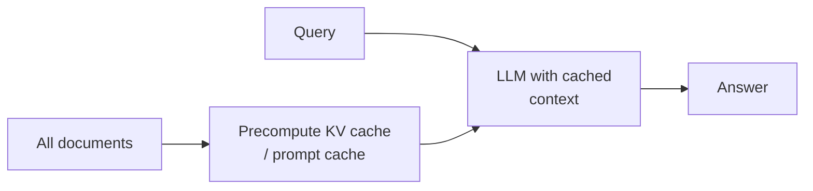

# 21. Cache-Augmented Generation (CAG)

**Category:** Retrieval-free Alternative  
**Core idea:** Preload the whole knowledge base into the LLM context and reuse the KV cache; no runtime retrieval.  
**Status:** Research collected. Implementation planned.

## Table of Contents

- [Overview](#overview)
- [Architecture](#architecture)
- [How It Works](#how-it-works)
- [When to Use](#when-to-use)
- [Limitations](#limitations)
- [Key Components](#key-components)
- [Research Papers](#research-papers)
- [Navigation](#navigation)

## Overview

When the knowledge base is small enough to fit in a long context window, CAG skips retrieval entirely. All documents are loaded once, the model's key-value cache is precomputed and stored, and each query reuses that cache. This removes retrieval errors and latency. Prompt caching APIs make this practical.

## Architecture

## How It Works

1. Check that the full knowledge base fits in the context window.
2. Load documents once and precompute the KV cache (or use provider prompt caching).
3. Answer each query against the cached context.
4. Reset or refresh the cache when the knowledge changes.

## When to Use

- Small, stable knowledge base (manuals, policies, FAQs).
- Retrieval errors are unacceptable.

## Limitations

- Bounded by context window size.
- Cost grows with knowledge size.

## Key Components

- Long-context LLM
- Prompt / KV cache
- Cache refresh job

## Research Papers

<table width="100%">
<thead><tr><th>#</th><th>Paper</th><th>Year</th><th>Venue / Org</th><th>arXiv</th><th>Local copy</th></tr></thead>
<tbody>
<tr><td>1</td><td>Don't Do RAG: When Cache-Augmented Generation is All You Need for Knowledge Tasks</td><td>2024</td><td>WWW 2025 Companion</td><td><a href="https://arxiv.org/abs/2412.15605">2412.15605</a></td><td><a href="papers/2412.15605_CAG.pdf">PDF</a></td></tr>
</tbody>
</table>

## Navigation

Previous: [20. Memory RAG](../20.%20Memory%20RAG/) | [Home](../README.md) | Next: [22. Modular RAG](../22.%20Modular%20RAG/)
