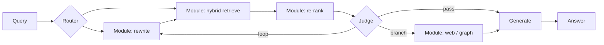

# 22. Modular RAG

> **Category:** Production Framework  
> **Core idea:** Treat RAG as LEGO: reconfigurable modules and operators (routing, scheduling, fusion) wired as a graph.  
> **Status:** Research collected. Implementation planned.

## Table of Contents

- [Overview](#overview)
- [Architecture](#architecture)
- [How It Works](#how-it-works)
- [When to Use](#when-to-use)
- [Limitations](#limitations)
- [Key Components](#key-components)
- [Research Papers](#research-papers)
- [Folder Structure](#folder-structure)
- [Navigation](#navigation)

## Overview

Modular RAG generalizes everything above. The system is decomposed into modules (indexing, pre-retrieval, retrieval, post-retrieval, generation, orchestration) and operators. Flow patterns (linear, conditional, branching, loop) combine them. This is the target design for the final production system in this repo.

## Architecture



## How It Works

1. Define each stage as an independent, swappable module with a clear interface.
2. Compose modules with flow patterns: linear, conditional, branching, loop.
3. Add orchestration: routing, scheduling, fusion.
4. Observe, evaluate and swap modules per use case.

## When to Use

- Production systems serving several use cases.
- Teams that need to A/B test components.

## Limitations

- Design overhead.
- Needs strong evaluation and observability.

## Key Components

- Module interfaces
- Orchestrator (LangGraph)
- Config-driven pipelines
- Evaluation + tracing

## Research Papers

<table width="100%">
<thead><tr><th>#</th><th>Paper</th><th>Year</th><th>Venue / Org</th><th>arXiv</th><th>Local copy</th></tr></thead>
<tbody>
<tr><td>1</td><td>Modular RAG: Transforming RAG Systems into LEGO-like Reconfigurable Frameworks</td><td>2024</td><td>arXiv (Tongji)</td><td><a href="https://arxiv.org/abs/2407.21059">2407.21059</a></td><td><a href="papers/2407.21059_Modular-RAG.pdf">PDF</a></td></tr>
</tbody>
</table>

## Folder Structure

```text
22-Modular-RAG/
├── README.md        # This file
└── papers/         # Research papers (PDF)
```

Implementation code (`src/`, `notebooks/`, `requirements.txt`) will be added when this architecture is built end to end.

## Navigation

[← Cache-Augmented Generation (CAG)](../21-Cache-Augmented-Generation/) | [Home](../README.md)
