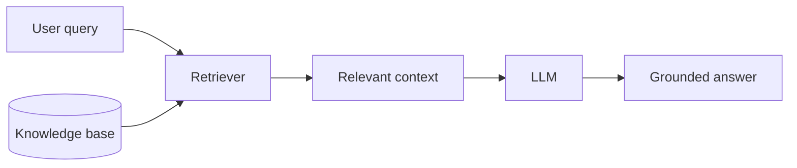

# RAG From Basics to Production

A structured, research-backed path through Retrieval-Augmented Generation (RAG) architectures: from the basic retrieve-then-read pipeline to self-correcting, graph-based, agentic, multimodal and modular production systems.

Each architecture has its own folder with a README (concept, architecture diagram, workflow, trade-offs) and the original research papers in a `papers` subfolder. The repo holds **22 architectures** and **34 papers**. Notes and end-to-end implementations are added one architecture at a time.

## Table of Contents

- [What is RAG](#what-is-rag)
- [Learning Path](#learning-path)
- [Architecture Index](#architecture-index)

## What is RAG

RAG connects a large language model to external knowledge. A retriever finds relevant content for a query, and the LLM generates an answer grounded in that content. This reduces hallucination, keeps answers current without retraining, and lets answers cite sources. The term comes from Lewis et al., 2020 ([arXiv:2005.11401](https://arxiv.org/abs/2005.11401)).

The survey by Gao et al. ([arXiv:2312.10997](https://arxiv.org/abs/2312.10997)) groups RAG into three paradigms: **Naive RAG**, **Advanced RAG** and **Modular RAG**. This repo follows that progression and adds the newer self-reflective, graph, agentic and multimodal families.

## Learning Path

<table width="100%">
<thead><tr><th>Stage</th><th>Folders</th><th>Focus</th></tr></thead>
<tbody>
<tr><td>Foundations</td><td>00 to 01</td><td>Surveys, evaluation, baseline retrieve-then-read pipeline.</td></tr>
<tr><td>Retrieval and Query Optimization</td><td>02 to 05</td><td>Query rewriting, re-ranking, hybrid search, HyDE, multi-query fusion.</td></tr>
<tr><td>Indexing Optimization</td><td>06 to 07</td><td>Better chunk units and hierarchical summary trees.</td></tr>
<tr><td>Self-Reflective and Adaptive</td><td>08 to 12</td><td>Pipelines that grade, correct, route and iterate on their own retrieval.</td></tr>
<tr><td>Graph-based</td><td>13 to 15</td><td>Knowledge graphs for relational and corpus-wide questions.</td></tr>
<tr><td>Agentic</td><td>16 to 17</td><td>Agents and RL-trained models that control search as a tool.</td></tr>
<tr><td>Multimodal and Long-context</td><td>18 to 21</td><td>Visual documents, long retrieval units, global memory, retrieval-free caching.</td></tr>
<tr><td>Production</td><td>22</td><td>Modular, reconfigurable RAG as the target production design.</td></tr>
</tbody>
</table>

## Architecture Index

<table width="100%">
<thead><tr><th>#</th><th>Architecture</th><th>Category</th><th>Core Idea</th><th>Key Paper</th><th>Papers</th><th>Status</th></tr></thead>
<tbody>
<tr><td>00</td><td><a href="00.%20RAG%20Surveys%20and%20Foundations/">RAG Surveys and Foundations</a></td><td>Reference</td><td>Survey papers, historical roots and evaluation frameworks used across every architecture.</td><td><a href="https://arxiv.org/abs/2312.10997">RAG-Survey</a> (2023)</td><td>8</td><td>Planned</td></tr>
<tr><td>01</td><td><a href="01.%20Naive%20RAG/">Naive (Basic) RAG</a></td><td>Foundational</td><td>Index, retrieve top-k chunks by vector similarity, stuff them into the prompt, generate.</td><td><a href="https://arxiv.org/abs/2005.11401">RAG-Lewis</a> (2020)</td><td>1</td><td>Notes ready</td></tr>
<tr><td>02</td><td><a href="02.%20Advanced%20RAG/">Advanced RAG</a></td><td>Retrieval Optimization</td><td>Add pre-retrieval (query rewriting) and post-retrieval (re-ranking, compression) stages to Naive RAG.</td><td><a href="https://arxiv.org/abs/2305.14283">Query-Rewriting</a> (2023)</td><td>2</td><td>Planned</td></tr>
<tr><td>03</td><td><a href="03.%20Hybrid%20Search%20RAG/">Hybrid Search RAG</a></td><td>Retrieval Optimization</td><td>Combine sparse keyword search (BM25) and dense vector search, then fuse the ranked lists.</td><td><a href="https://arxiv.org/abs/2404.07220">Blended-RAG</a> (2024)</td><td>1</td><td>Planned</td></tr>
<tr><td>04</td><td><a href="04.%20HyDE%20RAG/">HyDE RAG</a></td><td>Query Transformation</td><td>Generate a hypothetical answer document first, embed it, and use it to retrieve real documents.</td><td><a href="https://arxiv.org/abs/2212.10496">HyDE</a> (2022)</td><td>1</td><td>Planned</td></tr>
<tr><td>05</td><td><a href="05.%20RAG%20Fusion/">RAG-Fusion (Multi-Query)</a></td><td>Query Transformation</td><td>Generate several query variants, retrieve for each, merge with Reciprocal Rank Fusion.</td><td><a href="https://arxiv.org/abs/2402.03367">RAG-Fusion</a> (2024)</td><td>1</td><td>Planned</td></tr>
<tr><td>06</td><td><a href="06.%20Contextual%20Chunking%20RAG/">Contextual and Proposition Chunking RAG</a></td><td>Indexing Optimization</td><td>Index better units: atomic propositions, small-to-big parent chunks, or chunks prefixed with document context.</td><td><a href="https://arxiv.org/abs/2312.06648">Dense-X-Propositions</a> (2023)</td><td>1</td><td>Planned</td></tr>
<tr><td>07</td><td><a href="07.%20RAPTOR%20RAG/">RAPTOR (Hierarchical Tree RAG)</a></td><td>Indexing Optimization</td><td>Recursively cluster and summarize chunks into a tree; retrieve across all abstraction levels.</td><td><a href="https://arxiv.org/abs/2401.18059">RAPTOR</a> (2024)</td><td>1</td><td>Planned</td></tr>
<tr><td>08</td><td><a href="08.%20Self%20RAG/">Self-RAG</a></td><td>Self-Reflective</td><td>LLM decides when to retrieve and critiques its own output with reflection tokens.</td><td><a href="https://arxiv.org/abs/2310.11511">Self-RAG</a> (2023)</td><td>1</td><td>Planned</td></tr>
<tr><td>09</td><td><a href="09.%20Corrective%20RAG/">Corrective RAG (CRAG)</a></td><td>Self-Reflective</td><td>Grade retrieved documents; if quality is low, refine the query and fall back to web search.</td><td><a href="https://arxiv.org/abs/2401.15884">Corrective-RAG</a> (2024)</td><td>1</td><td>Planned</td></tr>
<tr><td>10</td><td><a href="10.%20Adaptive%20RAG/">Adaptive RAG</a></td><td>Self-Reflective / Routing</td><td>Classify query complexity and route to no-retrieval, single-step or multi-step retrieval.</td><td><a href="https://arxiv.org/abs/2403.14403">Adaptive-RAG</a> (2024)</td><td>1</td><td>Planned</td></tr>
<tr><td>11</td><td><a href="11.%20Active%20Iterative%20RAG/">Active and Iterative RAG (FLARE / IRCoT)</a></td><td>Iterative / Multi-hop</td><td>Retrieve repeatedly during generation: when confidence drops (FLARE) or after each reasoning step (IRCoT).</td><td><a href="https://arxiv.org/abs/2305.06983">FLARE</a> (2023)</td><td>2</td><td>Planned</td></tr>
<tr><td>12</td><td><a href="12.%20Speculative%20RAG/">Speculative RAG</a></td><td>Efficiency</td><td>Small specialist model drafts answers from document subsets in parallel; large model verifies the best draft.</td><td><a href="https://arxiv.org/abs/2407.08223">Speculative-RAG</a> (2024)</td><td>1</td><td>Planned</td></tr>
<tr><td>13</td><td><a href="13.%20Graph%20RAG/">Graph RAG</a></td><td>Graph-based</td><td>Extract an entity-relation knowledge graph, build community summaries, answer global and local queries.</td><td><a href="https://arxiv.org/abs/2404.16130">GraphRAG-Microsoft</a> (2024)</td><td>2</td><td>Planned</td></tr>
<tr><td>14</td><td><a href="14.%20LightRAG/">LightRAG</a></td><td>Graph-based</td><td>Graph-enhanced index with dual-level (low/high) keyword retrieval and cheap incremental updates.</td><td><a href="https://arxiv.org/abs/2410.05779">LightRAG</a> (2024)</td><td>1</td><td>Planned</td></tr>
<tr><td>15</td><td><a href="15.%20HippoRAG/">HippoRAG</a></td><td>Graph-based / Memory</td><td>Hippocampus-inspired: open KG plus Personalized PageRank for single-step multi-hop retrieval.</td><td><a href="https://arxiv.org/abs/2405.14831">HippoRAG</a> (2024)</td><td>1</td><td>Planned</td></tr>
<tr><td>16</td><td><a href="16.%20Agentic%20RAG/">Agentic RAG</a></td><td>Agentic</td><td>LLM agents plan, choose tools and retrievers, reflect and iterate until the task is solved.</td><td><a href="https://arxiv.org/abs/2501.09136">AgenticRAG-Survey</a> (2025)</td><td>1</td><td>Planned</td></tr>
<tr><td>17</td><td><a href="17.%20Reasoning%20Search%20RAG/">Reasoning Search RAG (Search-R1)</a></td><td>Agentic / RL</td><td>Train the LLM with reinforcement learning to interleave reasoning with search engine calls.</td><td><a href="https://arxiv.org/abs/2503.09516">Search-R1</a> (2025)</td><td>1</td><td>Planned</td></tr>
<tr><td>18</td><td><a href="18.%20Multimodal%20RAG/">Multimodal RAG</a></td><td>Multimodal</td><td>Retrieve over images, tables, charts and page screenshots, not only text.</td><td><a href="https://arxiv.org/abs/2210.02928">MuRAG</a> (2022)</td><td>4</td><td>Planned</td></tr>
<tr><td>19</td><td><a href="19.%20Long%20RAG/">LongRAG</a></td><td>Long-context</td><td>Use long retrieval units (4K+ tokens) and a long-context reader to cut retrieval burden.</td><td><a href="https://arxiv.org/abs/2406.15319">LongRAG</a> (2024)</td><td>1</td><td>Planned</td></tr>
<tr><td>20</td><td><a href="20.%20Memory%20RAG/">MemoRAG (Memory-Augmented RAG)</a></td><td>Long-context / Memory</td><td>A light memory model forms a global memory of the corpus and drafts clues that guide retrieval.</td><td><a href="https://arxiv.org/abs/2409.05591">MemoRAG</a> (2024)</td><td>1</td><td>Planned</td></tr>
<tr><td>21</td><td><a href="21.%20Cache%20Augmented%20Generation/">Cache-Augmented Generation (CAG)</a></td><td>Retrieval-free Alternative</td><td>Preload the whole knowledge base into the LLM context and reuse the KV cache; no runtime retrieval.</td><td><a href="https://arxiv.org/abs/2412.15605">CAG</a> (2024)</td><td>1</td><td>Planned</td></tr>
<tr><td>22</td><td><a href="22.%20Modular%20RAG/">Modular RAG</a></td><td>Production Framework</td><td>Treat RAG as LEGO: reconfigurable modules and operators (routing, scheduling, fusion) wired as a graph.</td><td><a href="https://arxiv.org/abs/2407.21059">Modular-RAG</a> (2024)</td><td>1</td><td>Planned</td></tr>
</tbody>
</table>

Papers are included for study and reference. Copyright stays with the original authors. Links point to the official arXiv pages.
